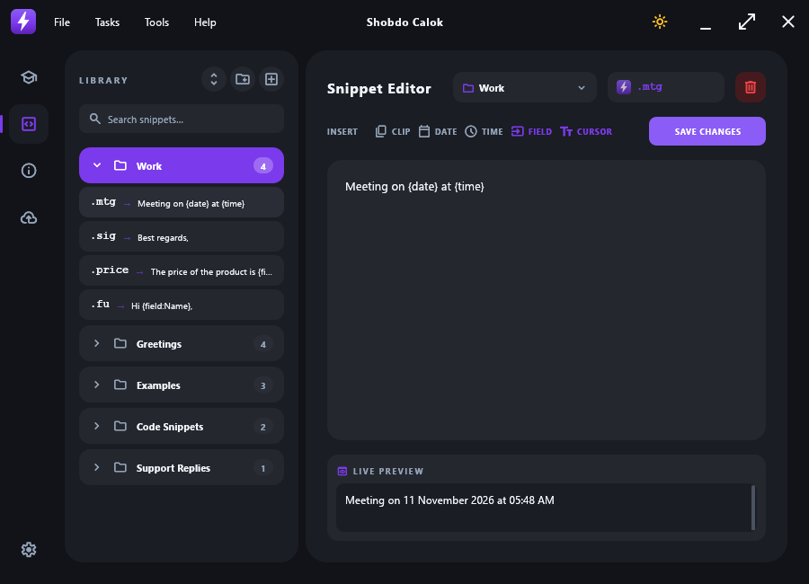
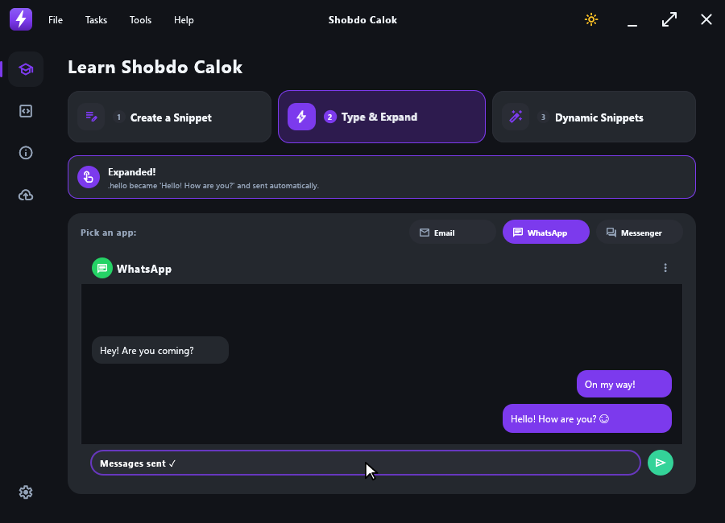
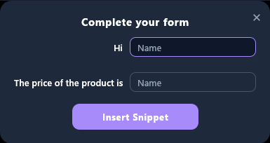
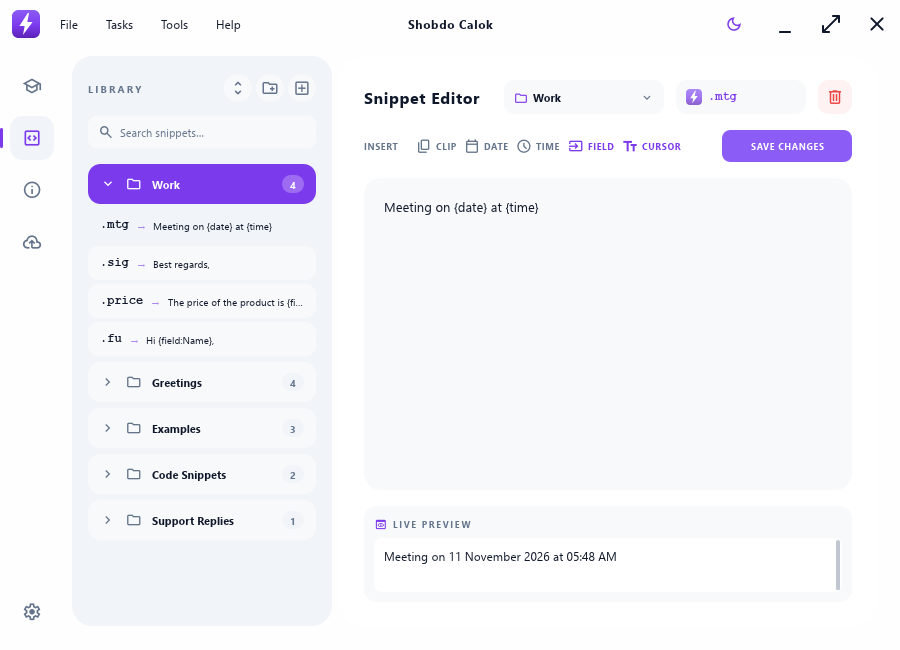

<div align="center">


# Shobdo Calok

**A fast, keyboard-friendly text expander for Windows.**
Type a short abbreviation anywhere — it turns into a full phrase, code block or smart template.

[](https://github.com/hungry-detective/TextExpand-ShobdoCalok/releases/latest/download/ShobdoCalok.exe)
[](https://github.com/hungry-detective/TextExpand-ShobdoCalok/releases/latest)
[](https://hungry-detective.github.io/TextExpand-ShobdoCalok/)


[](LICENSE)



</div>

## Features

- ⚡ **Expands in every app** — browser, Office, chat, email, code editors (word-boundary aware)
- 🧩 **Smart tokens** — `{date}`, `{time}`, `{datetime}`, `{date:%d/%m/%Y}`, `{clipboard}`, `{cursor}`, `{field:Label}` fill-in forms
- 📁 **Folders & search** — drag-and-drop reordering, move snippets between folders, right-click menus
- 🎓 **Animated built-in tutorial**
- ☁️ **Google Drive backup & restore** — sign in with your own Google account; plus JSON export/import
- 🌗 **System / Dark / Light** theme
- 🗂 **System tray** — pause/resume expansion, check for updates; **Run at startup** starts silently in the tray
- 💤 **Keeps working after sleep / hibernate / lock**
- 🚀 **One-click updates** from GitHub Releases — your data is never touched
- 🔄 **Portable** — one exe, data in an `AppData` folder next to it

| Tutorial | Fill-in form | Light mode |
|---|---|---|
|  |  |  |

📖 **Full guide with screenshots:** [docs/index.html](https://hungry-detective.github.io/TextExpand-ShobdoCalok/)

## Install

1. Download **[ShobdoCalok.exe](https://github.com/hungry-detective/TextExpand-ShobdoCalok/releases/latest/download/ShobdoCalok.exe)** (or the portable ZIP from [Releases](https://github.com/hungry-detective/TextExpand-ShobdoCalok/releases/latest)).
2. Put it in its own folder and run it. Your snippets are saved in `AppData\` beside it.
3. Type `.hello` in any app.

Upgrading from the old Python version: use **Check for Updates** in the old app, or drop the new exe into the same folder — your existing `AppData` is used as-is.

## Build from source

```bash
cargo build --release
# Output: target\release\ShobdoCalok.exe
```

Google Drive sign-in needs an OAuth client: copy `client_secret.example.json` to `client_secret.json` in the project root (it is git-ignored and gets embedded into the exe at build time). Release builds get it from the `GOOGLE_CLIENT_SECRET_JSON` repository secret.

## Releasing

Bump `version` in `Cargo.toml`, then:

```bash
git tag v2.0.1
git push origin v2.0.1
```

GitHub Actions builds the exe, the portable ZIP and its SHA256, and publishes the release.

## License

[GNU General Public License v3](LICENSE)
